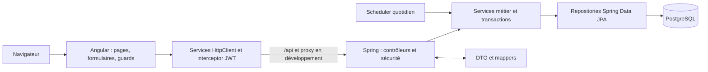
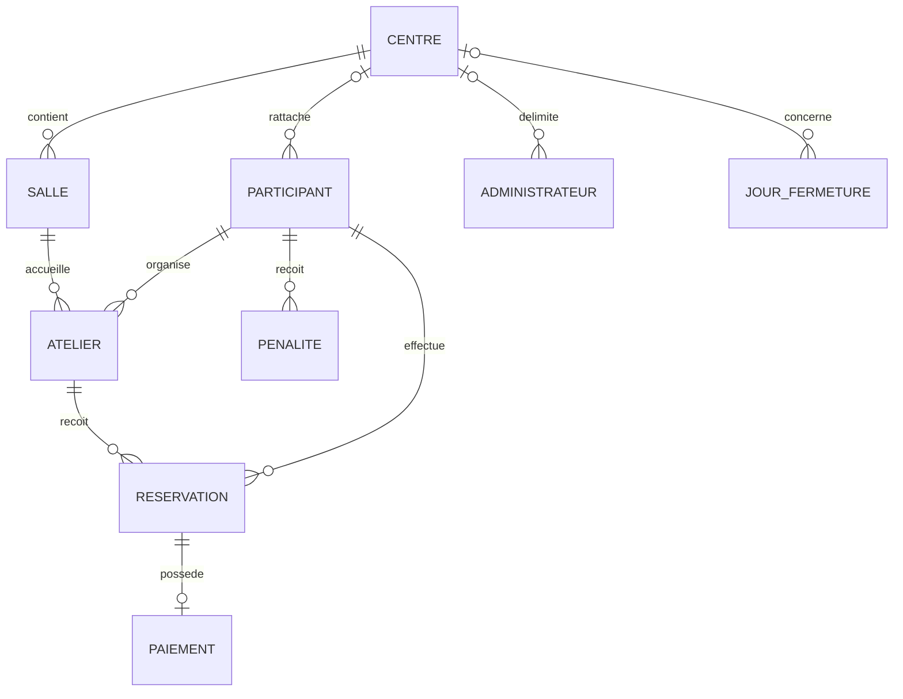
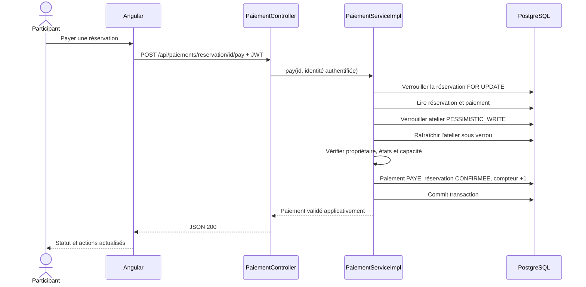

# Architecture, UML et données

Actualisation de la recette finale : création et déplacement d'atelier verrouillent
la salle cible avec `SalleService.getByIdForUpdate` dans la transaction métier,
avant de vérifier les chevauchements et la pause. Les mutations d'atelier utilisent
également son verrou et rechargent son état. Les sept scénarios PostgreSQL et leurs
méthodes exactes figurent dans la [matrice règles/tests](matrice-regles-tests.md).
Cela n'ajoute aucune contrainte SQL destructive ni migration de l'historique.

## Architecture en couches

Les contrôleurs valident les requêtes et délèguent. Les services appliquent les
règles et autorisations fines. Les repositories gèrent les requêtes et verrous.
Les DTO limitent le contrat JSON ; les entités ne servent pas de contrat public
général. Angular organise le parcours, mais n'est pas une frontière de sécurité.

`spring.jpa.open-in-view=false` oblige à charger les relations nécessaires dans
les transactions. Les graphes des repositories chargent notamment la salle, son
centre et l'organisateur. `SalleServiceImpl.update` possède une transaction métier :
la modification et le chargement du centre utilisent la même entité gérée, sans
merge détaché retournant une référence non initialisée au mapper du contrôleur.

## Entité-association logique

Un centre peut avoir zéro salle ; une salle appartient obligatoirement à un centre.
Un atelier possède une salle et un organisateur. Une réservation relie un atelier
à un participant ; son paiement est facultatif dans le modèle, mais est créé par
le parcours métier normal. Le rattachement d'un participant est nullable en SQL ;
la catégorie ABONNE impose le centre au niveau service. Une fermeture peut être
globale ou liée à un centre.

## Schéma relationnel physique existant

Chaque table possède `id` comme PK et les champs d'audit hérités de `BaseEntity`.
Les FK marquées `?` sont optionnelles dans le modèle JPA.

| Table SQL | Entité Java | Clés et attributs significatifs |
| --- | --- | --- |
| `sites` | Centre | PK id ; nom, adresse, heure_ouverture/fermeture, duree_match_minutes, duree_entre_match_minutes, annee_civile, ouvert_visiteurs |
| `terrains` | Salle | PK id ; FK site_id → sites ; nom, prix historique |
| `membres` | Participant | PK id ; matricule unique ; FK site_id? → sites ; type_membre, password_hash, solde, identité |
| `administrateurs` | Administrateur | PK id ; matricule et email uniques ; FK site_id? → sites ; type_administrateur, password_hash |
| `matches` | Atelier | PK id ; FK terrain_id → terrains ; FK organisateur_id → membres ; dates, type_match, statut, nb_joueurs_actuels, prix_total, prix_par_joueur, consentement et dates |
| `reservations` | Reservation | PK id ; FK match_id → matches ; FK membre_id → membres ; statut |
| `paiements` | Paiement | PK id ; FK reservation_id unique → reservations ; montant, statut, date_paiement |
| `penalites` | Penalite | PK id ; FK membre_id → membres ; date_fin, motif |
| `jours_fermeture` | JourFermeture | PK id ; FK site_id? → sites ; date, global, raison |

La base applicative inspectée comporte neuf PK, dix FK, quatre contraintes uniques
et six CHECK. Ce sont les nombres constatés sur cette base, pas une garantie que
toute base installée historiquement possède exactement le même schéma.

Les six places, les délais et la pause sont principalement des invariants de
service ; ils ne sont pas tous des CHECK SQL. Les contrôles de doublon participant/
atelier passent par le repository. Ne pas prétendre qu'une contrainte unique SQL
sur cette paire existe. L'accès SQL direct contourne les règles applicatives.

## Séquence du paiement applicatif

L'annulation verrouille aussi la réservation et ajuste le compteur sous verrou
d'atelier. Les invitations privées comptent les réservations non annulées sous ce
même verrou d'atelier. Les tests PostgreSQL vérifient ces courses avec deux appels
simultanés et non avec H2 uniquement.

## Sauvegarde, copie et conservation

Avant le démarrage sur données représentatives : `pg_dump -Fc` de
`atelierconnect_db`, restauration dans `atelierconnect_snapshot_phase4` sur le
serveur de test, comparaison des neuf tables par nombre et empreinte agrégée.
Les sauvegardes restent dans `.local/validation`, ignoré par Git.

La base d'origine n'a pas été lancée avec Hibernate pendant cette validation.
Le wrapper a démarré Spring Boot sur la copie, avec `ddl-auto=update`, puis les
endpoints publics et Swagger ont répondu 200. Une seconde comparaison des neuf
tables d'origine a confirmé qu'elles étaient inchangées.

Aucune suppression/recréation de table ou volume ; aucune modification des mots
de passe applicatifs existants ; aucun Flyway. La reprise des tarifs et durées
historiques exige un plan séparé, une sauvegarde et une décision métier explicite.
